# 信息化运维管理系统

面向单位内部的信息化设备报障与运维管理系统。**一房一码**：把二维码贴在房间门旁，谁发现设备故障，扫码就能报障，地点自动带入且可切换；普通用户无需注册登录；运维人员在后台受理、派单、上门处理，处理过程中领用的物资自动扣减库存，最后由报障人**手写签名**确认结单。

系统支持**邮件派单提醒**、**受理中心语音大屏（含超时预警）**、**电话报障代录**、**现场照片**、**多角色权限**、**值班排班**，以及工程师之间的**转派接收确认**。

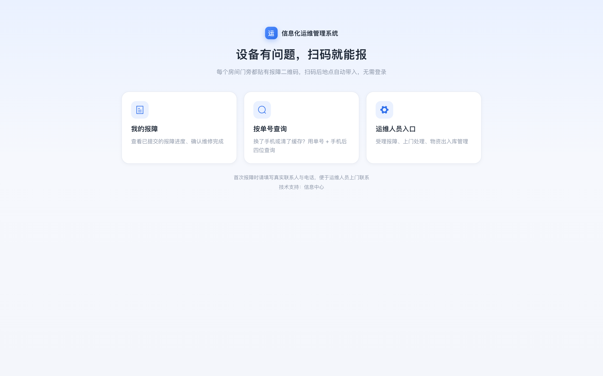

## 功能一览

| 模块 | 说明 |
| --- | --- |
| 扫码报障 | 一房一码，扫码自动带入地点（可切换）；填写设备、故障类型、描述、联系人、电话，**可立即上门，也可自选日期与时间点**；页面顶部固定提示「**非涉密系统，严禁上传涉密信息**」 |
| 现场照片 | 报障时可拍照/上传最多 3 张现场照片（前端自动压缩），后台与详情可直接预览大图 |
| 我的报障 | 扫码后输入**报障手机号后四位**即可查回该号码提交过的工单；签字确认时**手写签名** |
| 电话报障代录 | 受理员/管理员可直接代录电话报障，地点可选房间或手工输入，可同时指派处理人并触发邮件 |
| 工单受理 / 派单 | 待受理列表显示期望上门时间，受理时可指派上门/处理人员；受理员可随时改派 |
| 转派接收 | 工程师可将工单转给其他同事，**需对方在「待接收转派」中确认**；受理员改派立即生效 |
| 上门处理 | 开始处理、填写故障原因与处理说明、登记领用物资（自动扣库存）；未使用物资可勾选跳过 |
| 派单邮件提醒 | 派单、改派、转派时自动给处理人发邮件，正文带**查看工单 / 待接收转派**按钮链接；后台可配置 SMTP 并发送测试邮件 |
| 报障大屏 | 实时待受理列表、统计、时钟、**今日值班**；新报障自动弹横幅 + 提示音 + **语音播报**；**超时工单红色预警**；支持全屏 |
| 物资管理 | 台账、入库、出库、库存预警、流水、CSV 模板批量导入 |
| 设备台账 | 记录资产位置、上架时间、网络信息、管理地址与账号密码；支持 **Excel / CSV 批量导入**、按房间/类型/状态筛选、密码加密与管理员查看 |
| 物资分类 | 管理员/受理员维护分类与编号前缀，编号自动生成（XC-001、SB-001…） |
| 报障字典 | 故障类型、常用设备后台可维护，报障页实时生效 |
| 房间与二维码 | 新增/编辑房间、预览、批量打印 A4 标签、重新生成二维码 |
| 账号与权限 | **多角色权限**：一个账号可同时是受理员与工程师；管理员管理全部账号，受理员可管理运维工程师账号（新增、编辑邮箱、启停、重置密码） |
| 值班排班 | **整周固定值班人员（2 人及以上，可多选）**；支持某一天某个时间段**临时调班**；**值班中的工程师自动获得临时受理派单权限**；今日值班显示在大屏顶部 |
| 工作台 | 待受理/处理中/待确认、今日新增、平均处理时长、评分、高频地点与故障类型排行、待接收转派 |

## 界面预览

| 报障实时大屏（语音 + 超时预警 + 值班） | 电话报障代录 |
| --- | --- |
| 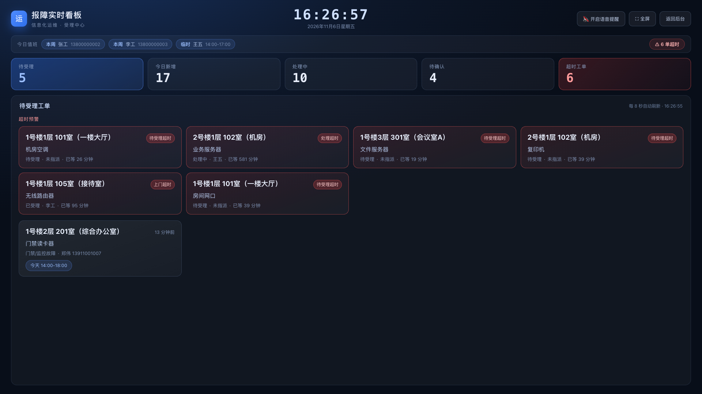 | 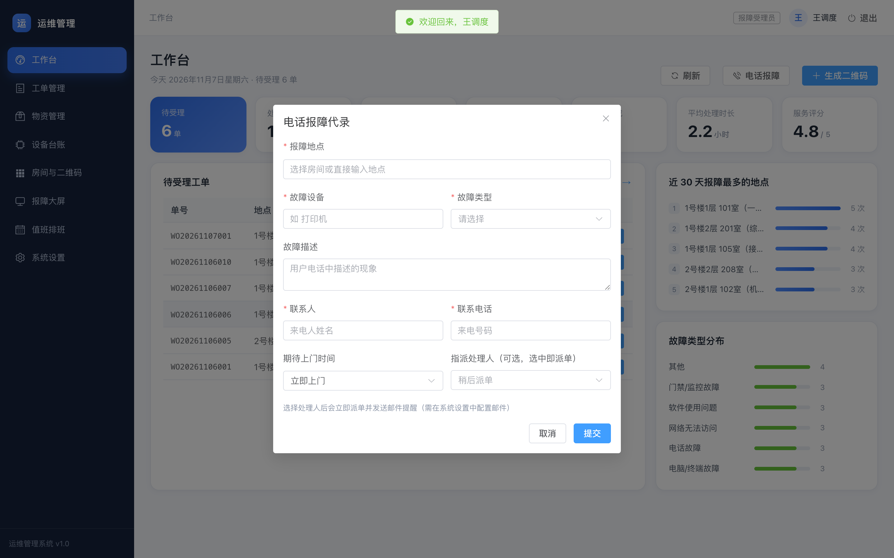 |

| 工作台（含待接收转派） | 工单管理 |
| --- | --- |
| 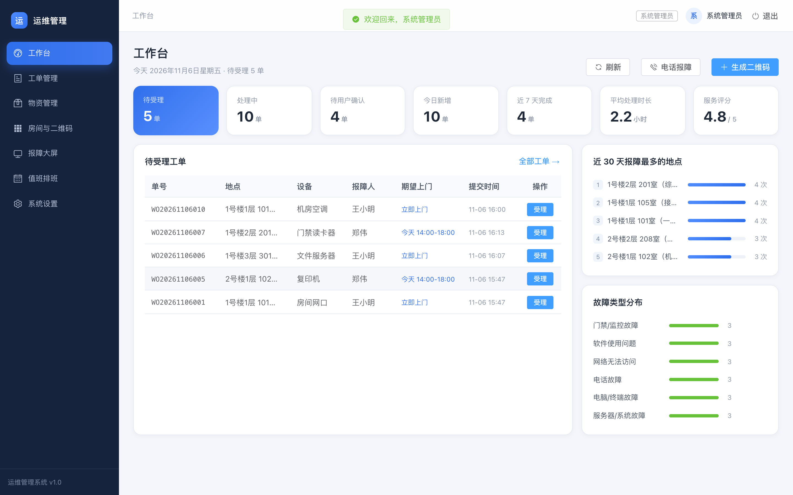 | 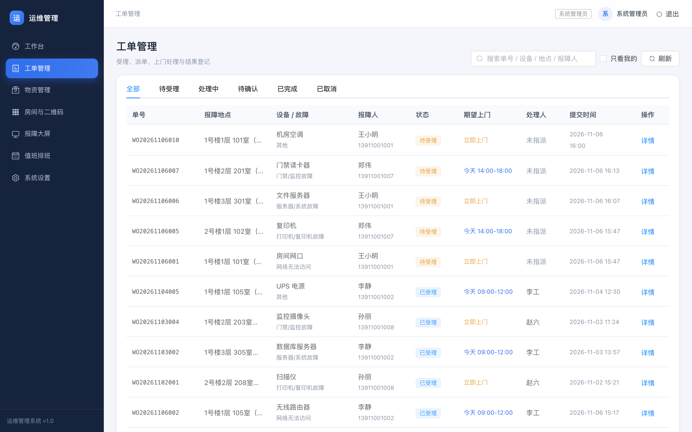 |

| 扫码报障（手机） | 手写签字确认 |
| --- | --- |
| 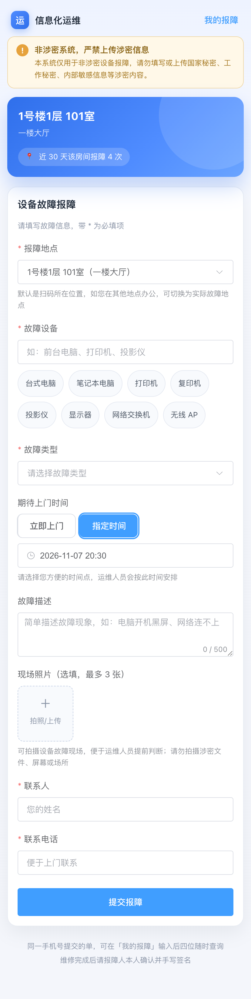 | 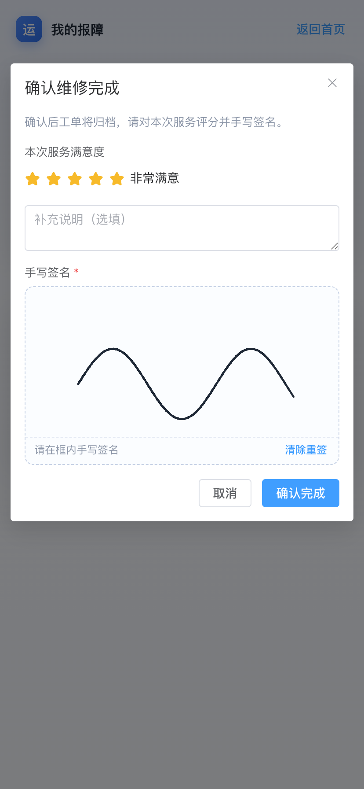 |

| 邮件通知配置 | 多角色账号与权限 |
| --- | --- |
| 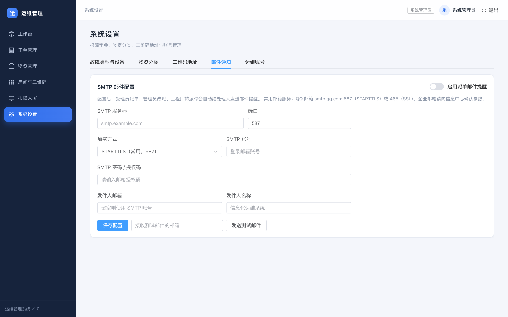 | 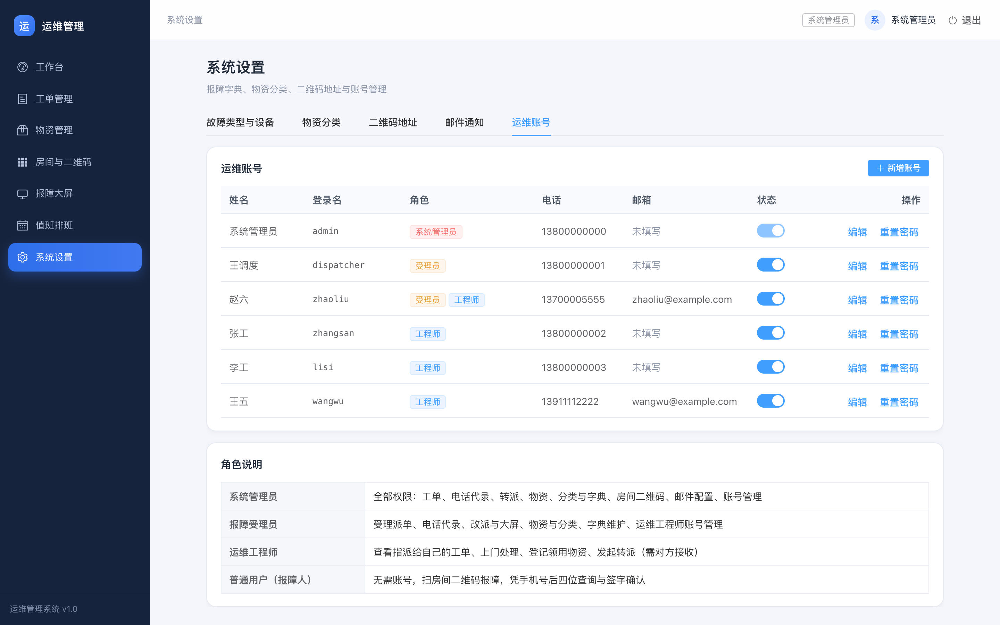 |

| 值班排班 | 现场照片 |
| --- | --- |
| 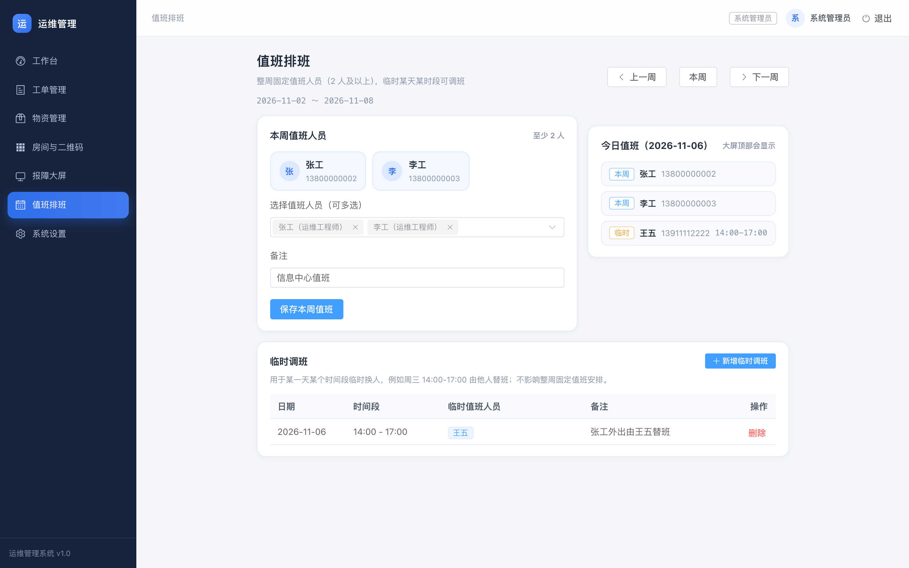 | 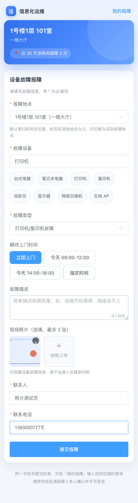 |

## 技术栈

- 后端：Python 3.9+ / FastAPI / SQLite（单文件数据库，零额外部署）
- 前端：Vue 3 / Vue Router / Element Plus / Vite
- 二维码：qrcode + Pillow（服务端生成 PNG，A4 网格打印页）
- 邮件：Python 标准库 smtplib（STARTTLS / SSL / 内网明文）
- 导入：openpyxl + csv；敏感字段：cryptography（Fernet）
- 语音：浏览器 Web Speech API + WebAudio 提示音（无需额外服务）

## 快速开始

```bash
cd "/Users/harv3y/Documents/work_space/物资管理"
./start.sh
```

首次运行自动创建虚拟环境、安装依赖并构建前端（需联网）。启动后终端会打印访问地址：

```
本机访问：http://127.0.0.1:8008
局域网访问：http://10.133.254.62:8008
运维后台：http://127.0.0.1:8008/login
报障大屏：http://127.0.0.1:8008/board
```

> 手机扫码报障必须使用**局域网访问地址**（手机与本机同一 WiFi / 内网）。二维码里编码的就是这个地址。

### 默认账号（首次启动自动创建，请登录后修改密码）

> 为避免账号信息暴露，登录页不再展示默认账号；账号密码仅保留在本文档中。

| 角色 | 账号 | 密码 | 权限 |
| --- | --- | --- | --- |
| 系统管理员 | `admin` | `admin123` | 全部功能：工单、物资、分类与字典、房间、邮件配置、账号 |
| 报障受理员 | `dispatcher` | `dispatch123` | 受理派单、电话代录、大屏、物资与分类、字典、工程师账号 |
| 运维工程师 | `zhangsan` / `lisi` / `wangwu` | `eng123` | 处理指派给自己的工单、登记物资、发起转派 |
| 受理员 + 工程师 | `zhaoliu` | `eng123` | 多角色示例：既能受理派单，也能作为处理人 |

## 使用流程

```
房间二维码  →  普通用户扫码填单（地点可切换、期待上门时间）
                     ↓
     受理员受理并指派处理人（自动发邮件给处理人）
                     ↓
        处理人开始上门（已受理 → 处理中）
                     ↓
   填写处理结果（使用物资则扣库存，未使用可勾选跳过）（→ 待确认）
                     ↓
   报障人手机号后四位查单 → 手写签名 + 评价（→ 已完成）
```

### 1. 生成并打印二维码

「房间与二维码」→ 新增房间 → 勾选 → 「打印选中标签」→ 浏览器打印 / 另存为 PDF，A4 三列排版。

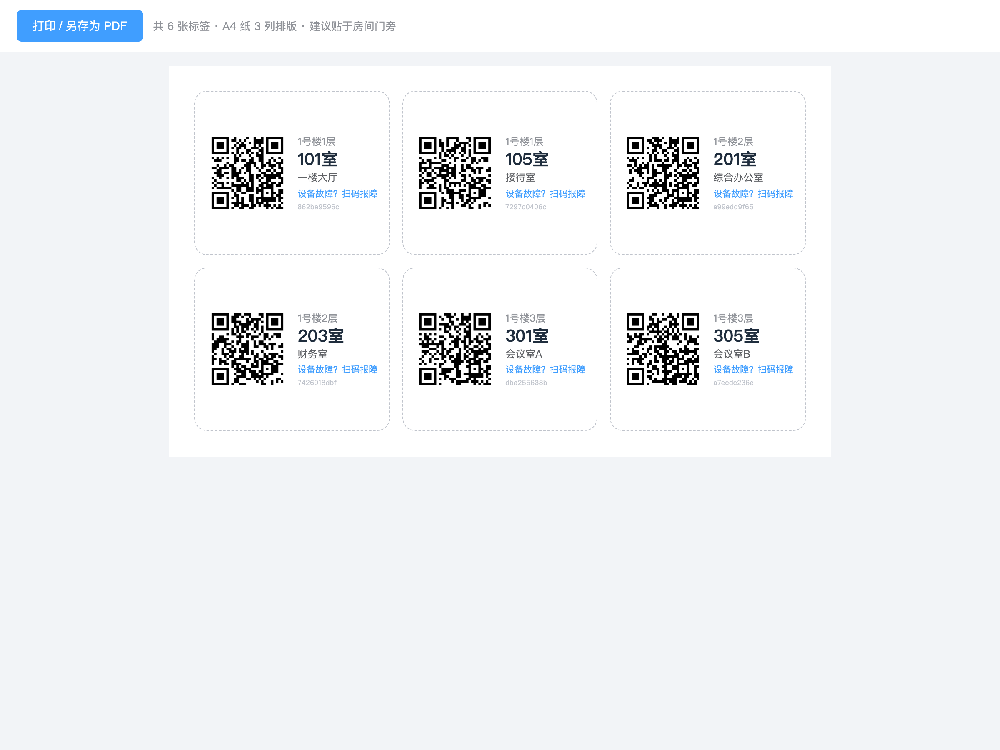

> 二维码内容为 `http://<服务器IP>:8008/r/<房间码>`。默认自动使用本机局域网 IP；IP 变化或改用内网域名时，到「系统设置 → 二维码地址」更新后重新打印。

### 2. 电话报障代录

受理员登录后在「工作台」右上角点「电话报障」：选择/输入地点、设备、故障类型、来电人电话、期望上门时间；如选择处理人，提交即完成受理派单并发送邮件提醒，不需要等用户扫码。

### 3. 转派与接收

- **受理员改派**：工单详情 →「改派」，立即生效，并邮件通知新处理人。
- **工程师转派**：工单详情 →「转派他人」→ 选择同事并填写原因。工单进入「待接收」，对方登录后在工作台看到「待接收转派」，点「接收」后处理人变更（拒绝则保留原处理人）。
- 转派全程记录在工单进度里。

### 4. 多角色权限

账号可同时勾选多个角色（例如「受理员 + 运维工程师」），权限取并集：

- 受理员：受理派单、电话代录、改派、大屏、值班、物资与分类、字典、工程师账号
- 运维工程师：处理指派给自己的工单、登记物资、发起转派
- 管理员：全部权限（含邮件配置、全部账号、房间二维码）

在「系统设置 → 运维账号」新增或编辑时勾选角色即可。受理员仍然只能管理“纯工程师”账号，不能给别人加管理员/受理员角色。

### 5. 值班排班

菜单「值班排班」按周管理：

- **本周值班人员**：多选 2 人及以上，整周有效，保存后显示为人员卡片
- **临时调班**：针对某一天某个时间段临时换人，例如「11-06 14:00-17:00 王五替班」，不影响整周固定安排；可多条、可删除
- 大屏顶部「今日值班」会同时显示本周固定人员与今天的临时替班（临时项带时间段）

**值班受理权限**：工程师在本周值班名单内，或处于当天临时调班时间段内时，会自动获得「值班受理」权限——可受理、派单、改派、关闭工单、电话代录，工作台会出现「电话报障」按钮，顶部显示「值班受理中」标签；值班结束后权限自动收回。该权限**不含**账号管理、物资维护、系统设置等。

### 6. 邮件派单提醒

1. 管理员进入「系统设置 → 邮件通知」
2. 填写 SMTP 服务器、端口、加密方式（STARTTLS / SSL / 不加密）、账号、授权码、发件人
3. 打开「启用派单邮件提醒」→ 保存 → 填写测试邮箱点「发送测试邮件」
4. 之后派单/改派/转派都会自动发信，工单详情中的处理人需提前填好邮箱

常用参数：QQ 邮箱 `smtp.qq.com` + 587（STARTTLS）或 465（SSL），密码处填**授权码**；企业邮箱请向信息中心获取。

### 7. 受理中心大屏

- 地址：`http://127.0.0.1:8008/board`（管理员/受理员菜单里也有入口）
- 每 8 秒刷新，新报障自动弹出横幅、播放提示音并语音播报「地点 + 设备 + 故障类型」
- **超时预警**：待受理超过 15 分钟、受理后 60 分钟未上门、处理中超过 4 小时，会以红色卡片列出并计入「超时工单」
- 顶部显示**今日值班**（本周固定人员 + 当日临时替班时间段）
- 浏览器限制自动播放，**首次进入需点一下「开启语音提醒」**，之后会记住该设置
- 右上角「全屏」适合挂在受理中心电视/显示器上

### 8. 设备台账

菜单「设备台账」用于管理机房与办公设备资产：

- 记录字段：资产编号、设备名称、类型、品牌型号、序列号、所在房间、机柜位置、上架时间、状态、网络信息、管理地址、管理账号/密码、管理端口、责任人、供应商、保修到期、备注
- 资产编号留空时自动生成 `ZC-0001` 形式；列表支持按名称/IP/责任人搜索，按类型、状态、房间筛选
- **管理密码使用 Fernet 加密存储**，列表与详情默认脱敏，仅管理员可点「显示密码」查看并复制，所有查看走服务端鉴权
- 「导入」支持 **.xlsx / .csv**，模板自带示例行与填写说明；导入逐行校验并提示错误行号

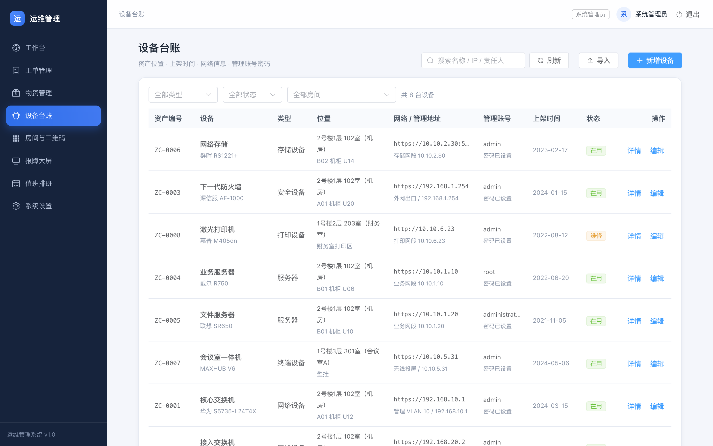

### 9. 物资分类与编号

- 默认分类：**线材（XC）**、**设备（SB）**、**其它（QT）**
- 新增物资自动编号：分类前缀 + 三位序号，如 `XC-001`、`SB-012`
- 分类可由管理员/受理员在「系统设置 → 物资分类」维护；有物资的分类不能删除

### 10. 批量导入物资

「物资管理」→「批量导入」→「下载导入模板（CSV）」→ 填写后另存为 CSV 上传。列：名称、分类、规格、单位、初始库存、预警库存、存放位置、单价、备注（编号留空自动生成）。

## 目录结构

```
物资管理/
├── start.sh                  # 一键启动
├── backend/
│   ├── data/ops.db           # SQLite 数据库（备份拷贝此目录）
│   └── app/
│       ├── main.py           # FastAPI 入口
│       ├── db.py             # 表结构、初始化、演示数据、历史迁移
│       ├── security.py       # 密码、会话、匿名报障人身份
│       ├── mailer.py         # SMTP 配置与派单/转派邮件
│       ├── crypto.py         # 设备管理密码加解密
│       ├── media.py          # 报障现场照片存储
│       ├── tickets_common.py # 工单编号、日志、详情
│       └── routers/
│           ├── public.py       # 扫码报障、手机号后四位查询、签字确认
│           ├── staff_auth.py   # 登录、账号管理、邮件配置与测试
│           ├── staff_tickets.py# 受理、派单、电话代录、转派、统计
│           ├── materials.py    # 物资、分类编号、出入库、模板导入
│           ├── assets.py       # 设备台账、Excel/CSV 导入、密码查看
│           ├── config.py       # 故障类型 / 设备字典
│           ├── duty.py         # 值班排班
│           └── rooms.py        # 房间、二维码、标签打印
├── frontend/
│   ├── src/views/            # Report / Mine / Login / Dashboard / Board / Tickets / Materials / Assets / Rooms / Duty / Settings
│   ├── src/components/       # TicketDetail / SignPad
│   └── dist/                 # 构建产物
└── docs/screenshots/
```

## 演示数据

首次启动会生成基础数据（8 个房间、13 种物资、4 个账号、9 类故障类型、14 种设备）。代码仓库另附脚本可批量生成更完整的演示工单：

```bash
./.venv/bin/python tools/seed_demo_tickets.py
```

当前库中为脚本生成的 27 条演示工单：

- 覆盖全部 9 类故障，每类 3 条
- 覆盖全部状态：待受理 5、已受理 5、处理中 5、待确认 4、已完成 4、已取消 4
- 含故障原因/处理说明、领用物资与出库流水、手写签名、现场照片、电话代录等示例
- 另有 1 条待王五接收的转派（工单 `WO20261106002`）

> 脚本按当前库存扣减领用物资；重复执行会继续追加数据。

## 测试版模式（免密登录 + 模拟数据）

测试分支可开启测试模式，**仅用于内部测试环境，正式环境切勿开启**：

```bash
./start-test.sh
# 等价于：OPS_TEST_MODE=1 OPS_SEED_TEST_DATA=1 ./start.sh
```

- `OPS_TEST_MODE=1`：登录页显示「测试环境 · 免密登录」，点击账号即可进入；接口层同时跳过密码校验。
- `OPS_SEED_TEST_DATA=1`：首次启动自动写入 24 条测试工单、6 台测试设备及物资领用记录（`WOT` / `TEST` 前缀），重复启动不会重复写入。
- Dokploy 部署时，在测试应用的 Environment 中设置这两个变量为 `1` 即可；正式应用保持 `0` 或不设置。

## 使用手册

分角色操作手册（Word / PDF）：[信息化运维管理系统-使用手册.docx](信息化运维管理系统-使用手册.docx) · [PDF](信息化运维管理系统-使用手册.pdf)

按「报障人、受理员、工程师、管理员」分章，含操作步骤表与系统截图。

## 部署到 Dokploy / Docker

项目内置 `Dockerfile`、`docker-compose.yml` 与 `.dockerignore`，可直接在 Dokploy 以 Dockerfile 或 Compose 方式部署：

- 容器端口：`8008`
- 持久化卷：挂载到 `/app/backend/data`（SQLite + 上传照片）
- 环境变量：`TZ=Asia/Shanghai`、`OPS_PUBLIC_BASE_URL=https://你的域名`
- 保持单副本（SQLite）

完整步骤、域名/卷/备份/升级与排错见 **[DEPLOY-DOKPLOY.md](DEPLOY-DOKPLOY.md)**。

## 数据与备份

- 数据在 `backend/data/ops.db`（SQLite，WAL）。**备份**：停服后复制 `backend/data/`。
- **清空重来**：停服后删除 `backend/data/ops.db*`，重启会重建演示数据。
- 启动时自动做兼容迁移：补 `email`、`source`、转派表、邮件配置项等，无需手工处理。
- 接口文档：<http://127.0.0.1:8008/api/docs>

## 安全说明

- 普通用户由服务端签发随机会话 Cookie（HttpOnly、SameSite=Lax），数据库只存哈希。
- 报障查询使用「手机号后四位」，适合内网低风险场景；如需更强校验可加姓名或查询码。
- 签字确认校验 PNG DataURL 并限制大小；查询/提交均有频率限制。
- 运维端密码 PBKDF2-SHA256 加盐存储，会话 7 天过期。
- SMTP 密码保存在本地 SQLite 中，仅管理员可读写；请为系统单独申请邮箱授权码，不要使用个人主密码。
- 设备管理密码使用 Fernet 对称加密存储，解密接口仅管理员可调用；普通页面只显示「已设置」。
- 邮件通知失败不会阻断派单（后台发送，失败静默），可通过「发送测试邮件」排查配置。

## 常见问题

**手机扫码打不开？** 手机与电脑需同一局域网；二维码 IP 需为本机局域网 IP；macOS 首次启动弹窗选「允许」；访问 `http://<本机IP>:8008/api/health` 应返回 `{"ok":true}`。

**大屏没有声音？** 浏览器禁止自动播放，需点一次「开启语音提醒」；确认系统音量与浏览器标签未被静音；语音使用系统内置中文语音包。

**照片打不开/上传失败？** 单张压缩后约 200-400KB，限制 2MB；照片保存在 `backend/data/uploads/`，备份时随 `backend/data/` 一起拷贝。若反向代理，需放行 `/uploads` 路径。

**邮件发不出去？** 在「系统设置 → 邮件通知」点「发送测试邮件」看具体报错；常见原因：端口/加密方式不匹配、用了登录密码而非授权码、企业邮箱需开 SMTP 服务、网络限制。

**端口 8008 被占用？** `PORT=8010 ./start.sh`，同时到系统设置更新二维码地址。

**前端改了怎么生效？** `cd frontend && npm run build`，刷新浏览器即可，后端无需重启。

## 后续可扩展

- 报障现场照片上传
- 短信/企业微信通知、SLA 超时提醒
- 邮件模板自定义、抄送值班组
- 物资领料单、报废盘点
- 工单与耗材成本报表导出
